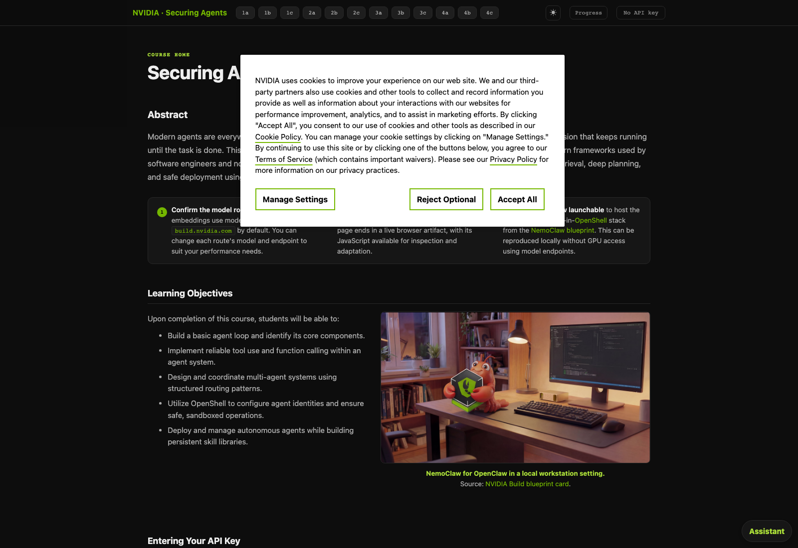
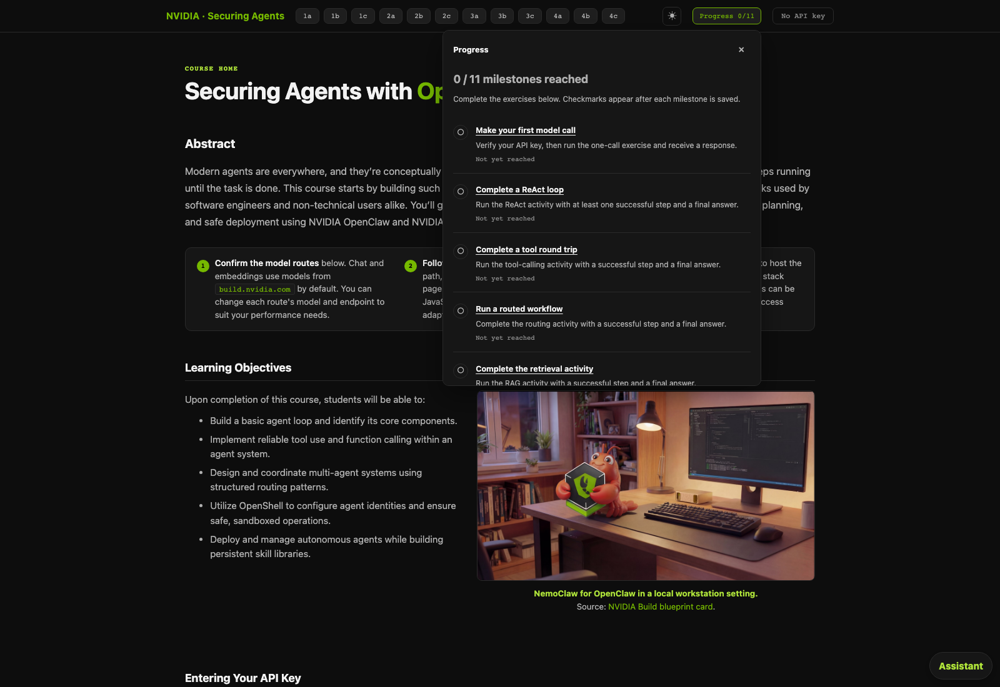
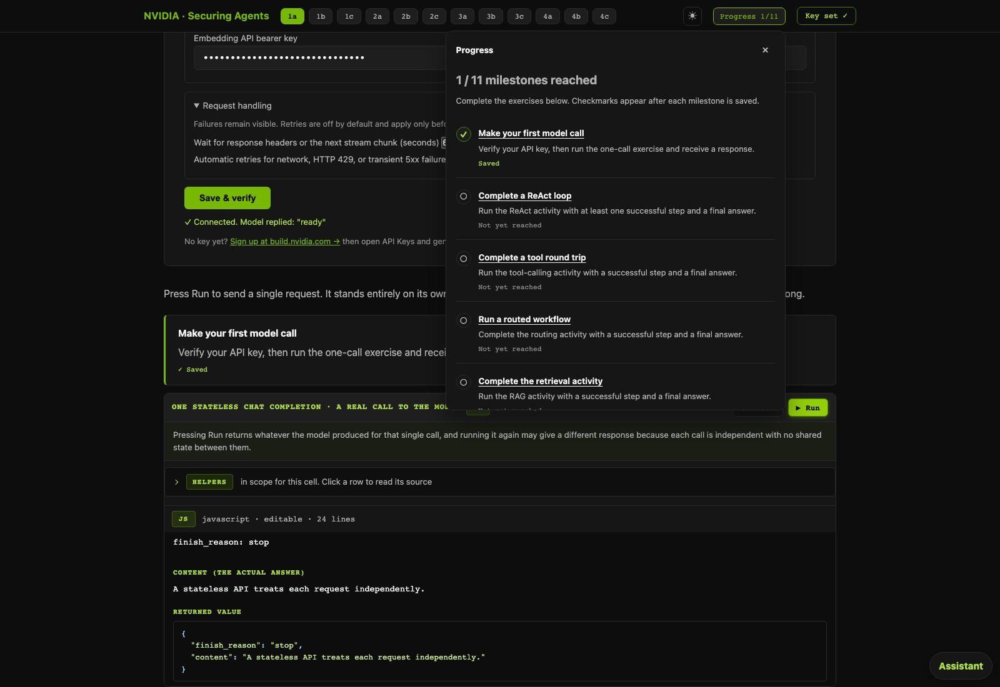
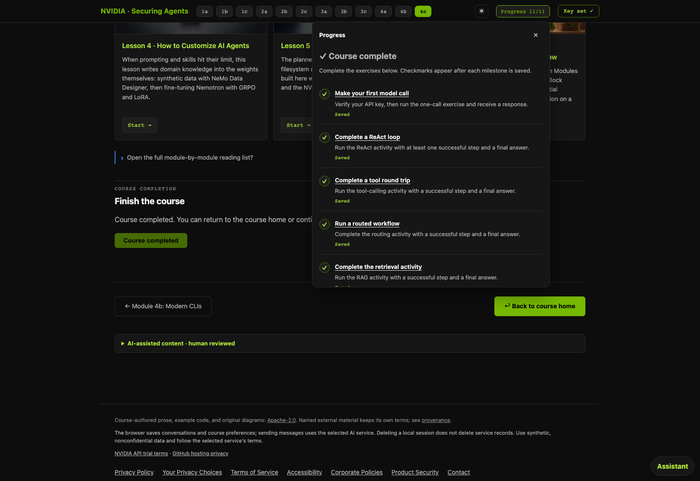
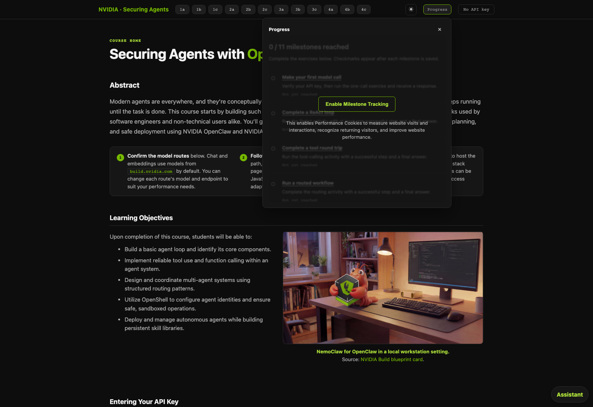

# PR #174 browser validation evidence

PASS: five browser cases on course commit `0adfc75ec959889126efac7cf8077752c0249359`, 2026-10-15T00:20:53.212Z–2026-10-15T00:21:16.123Z. Candidate static files were served locally under the intended browser origin `https://nvdli.github.io`. The browser used the real production Activity API and real OneTrust notice. Model replies and external lab success events were simulated; this is not a deployed-site or real external-lab test. Screenshots show the scrollable checklist viewport; all 11 definitions and completion timestamps were asserted and retained in JSON.

### 1. PASS — Cookie opt-in shown
The real OneTrust notice is visible before a saved choice. No Activity API requests occur.



### 2. PASS — Opt-in reveals milestones
Accept All grants Performance Cookies. Session creation sends only the three artifact fields and returns 201; production state contains all 11 milestone definitions, initially incomplete. The opt-in overlay disappears and the summary shows 0/11.



### 3. PASS — First milestone completed
Use the authored Save & verify and Run controls with a simulated model reply. The first milestone update returns 202 (queued); a subsequent state GET confirms its completion timestamp. The UI shows Saved and 1/11.



### 4. PASS — All milestones and course completed
Navigate the remaining exercises and simulate their defined success events. Production state confirms all 11 milestone timestamps. Finish Course submits the completed update (202); subsequent state confirms course completion. Reload preserves 11/11 and Course completed.



### 5. PASS — Declined cookies require opt-in
Reject Optional in a fresh browser context. The muted milestone preview is inert; Enable Milestone Tracking and its Performance Cookies explanation are visible. No Activity API requests occur.



### Activity API calls (separate network evidence)
Base: `https://activity-api.learn.nvidia.com`. Session creation sends exactly:

```json
{
  "artifact_id": "artifact_nemoclaw_web",
  "artifact_version": "git-0adfc75ec959889126efac7cf8077752c0249359",
  "artifact_digest": "sha256:f177874fd1c643fd37f53b99b9b9c4912c1078775c6defc380aef143cd617308"
}
```

Milestone definitions are not sent in the session. Updates send only the typed event and milestone ID, or an empty payload for course completion. Updates return 202, so Saved/completed assertions wait for authoritative state GETs. Session creation is unauthenticated; state/updates use the session bearer token, and updates carry idempotency keys. Tokens are redacted; cookie values, model credentials, prompts and model output are excluded. The full JSON preserves selected headers, typed request bodies and sanitized responses.

| Case | SDK requests | Browser OPTIONS | Total |
|---|---:|---:|---:|
| 1 | 0 | 0 | 0 |
| 2 | 2 | 2 | 4 |
| 3 | 7 | 7 | 14 |
| 4 | 77 | 77 | 154 |
| 5 | 0 | 0 | 0 |

This run captured **172 HTTP requests: 86 SDK requests and 86 browser CORS preflights**. SDK requests: one session POST (201), eleven milestone update POSTs (202), one course-completion POST (202), and 73 state GETs (200). All 86 OPTIONS returned 204. Counts reflect this run, including navigation, polling and reload; they are not a fixed per-learner budget.


[Complete sanitized request/response trace](activity-api-calls.json) · [Case assertions and milestone results](validation.json)

<details>
<summary>All 172 captured HTTP requests, including CORS preflights</summary>

Capture sequence records request initiation, not wire/completion order; a preflight can appear after its SDK request at the same timestamp. In paths below, `{session_id}` = `01a13cee-f455-7740-90a6-b281c639c39f`. Full timestamps, headers and response bodies are in the linked JSON.

| Capture sequence | Case | Request | Path | Status | Request body |
|---:|---:|---|---|---:|---|
| 1 | 2 | SDK POST | `/v1/activity-sessions` | 201 | `{"artifact_id":"artifact_nemoclaw_web","artifact_version":"git-0adfc75ec959889126efac7cf8077752c0249359","artifact_digest":"sha256:f177874fd1c643fd37f53b99b9b9c4912c1078775c6defc380aef143cd617308"}` |
| 2 | 2 | Browser OPTIONS | `/v1/activity-sessions` | 204 | — |
| 3 | 2 | SDK GET | `/v1/activity-sessions/{session_id}/state` | 200 | — |
| 4 | 2 | Browser OPTIONS | `/v1/activity-sessions/{session_id}/state` | 204 | — |
| 5 | 3 | SDK GET | `/v1/activity-sessions/{session_id}/state` | 200 | — |
| 6 | 3 | Browser OPTIONS | `/v1/activity-sessions/{session_id}/state` | 204 | — |
| 7 | 3 | SDK GET | `/v1/activity-sessions/{session_id}/state` | 200 | — |
| 8 | 3 | Browser OPTIONS | `/v1/activity-sessions/{session_id}/state` | 204 | — |
| 9 | 3 | SDK GET | `/v1/activity-sessions/{session_id}/state` | 200 | — |
| 10 | 3 | Browser OPTIONS | `/v1/activity-sessions/{session_id}/state` | 204 | — |
| 11 | 3 | SDK GET | `/v1/activity-sessions/{session_id}/state` | 200 | — |
| 12 | 3 | Browser OPTIONS | `/v1/activity-sessions/{session_id}/state` | 204 | — |
| 13 | 3 | SDK POST | `/v1/activity-sessions/{session_id}/updates` | 202 | `{"type":"milestone_completed","payload":{"milestone_id":"01a:model-call-verified"}}` |
| 14 | 3 | Browser OPTIONS | `/v1/activity-sessions/{session_id}/updates` | 204 | — |
| 15 | 3 | SDK GET | `/v1/activity-sessions/{session_id}/state` | 200 | — |
| 16 | 3 | Browser OPTIONS | `/v1/activity-sessions/{session_id}/state` | 204 | — |
| 17 | 3 | SDK GET | `/v1/activity-sessions/{session_id}/state` | 200 | — |
| 18 | 3 | Browser OPTIONS | `/v1/activity-sessions/{session_id}/state` | 204 | — |
| 19 | 4 | SDK GET | `/v1/activity-sessions/{session_id}/state` | 200 | — |
| 20 | 4 | Browser OPTIONS | `/v1/activity-sessions/{session_id}/state` | 204 | — |
| 21 | 4 | SDK GET | `/v1/activity-sessions/{session_id}/state` | 200 | — |
| 22 | 4 | Browser OPTIONS | `/v1/activity-sessions/{session_id}/state` | 204 | — |
| 23 | 4 | SDK GET | `/v1/activity-sessions/{session_id}/state` | 200 | — |
| 24 | 4 | Browser OPTIONS | `/v1/activity-sessions/{session_id}/state` | 204 | — |
| 25 | 4 | SDK GET | `/v1/activity-sessions/{session_id}/state` | 200 | — |
| 26 | 4 | Browser OPTIONS | `/v1/activity-sessions/{session_id}/state` | 204 | — |
| 27 | 4 | SDK POST | `/v1/activity-sessions/{session_id}/updates` | 202 | `{"type":"milestone_completed","payload":{"milestone_id":"01b:react-loop-complete"}}` |
| 28 | 4 | Browser OPTIONS | `/v1/activity-sessions/{session_id}/updates` | 204 | — |
| 29 | 4 | SDK GET | `/v1/activity-sessions/{session_id}/state` | 200 | — |
| 30 | 4 | Browser OPTIONS | `/v1/activity-sessions/{session_id}/state` | 204 | — |
| 31 | 4 | SDK GET | `/v1/activity-sessions/{session_id}/state` | 200 | — |
| 32 | 4 | Browser OPTIONS | `/v1/activity-sessions/{session_id}/state` | 204 | — |
| 33 | 4 | SDK GET | `/v1/activity-sessions/{session_id}/state` | 200 | — |
| 34 | 4 | Browser OPTIONS | `/v1/activity-sessions/{session_id}/state` | 204 | — |
| 35 | 4 | SDK GET | `/v1/activity-sessions/{session_id}/state` | 200 | — |
| 36 | 4 | Browser OPTIONS | `/v1/activity-sessions/{session_id}/state` | 204 | — |
| 37 | 4 | SDK GET | `/v1/activity-sessions/{session_id}/state` | 200 | — |
| 38 | 4 | Browser OPTIONS | `/v1/activity-sessions/{session_id}/state` | 204 | — |
| 39 | 4 | SDK GET | `/v1/activity-sessions/{session_id}/state` | 200 | — |
| 40 | 4 | Browser OPTIONS | `/v1/activity-sessions/{session_id}/state` | 204 | — |
| 41 | 4 | SDK POST | `/v1/activity-sessions/{session_id}/updates` | 202 | `{"type":"milestone_completed","payload":{"milestone_id":"01c:tool-roundtrip-complete"}}` |
| 42 | 4 | Browser OPTIONS | `/v1/activity-sessions/{session_id}/updates` | 204 | — |
| 43 | 4 | Browser OPTIONS | `/v1/activity-sessions/{session_id}/state` | 204 | — |
| 44 | 4 | SDK GET | `/v1/activity-sessions/{session_id}/state` | 200 | — |
| 45 | 4 | SDK GET | `/v1/activity-sessions/{session_id}/state` | 200 | — |
| 46 | 4 | Browser OPTIONS | `/v1/activity-sessions/{session_id}/state` | 204 | — |
| 47 | 4 | SDK GET | `/v1/activity-sessions/{session_id}/state` | 200 | — |
| 48 | 4 | Browser OPTIONS | `/v1/activity-sessions/{session_id}/state` | 204 | — |
| 49 | 4 | SDK GET | `/v1/activity-sessions/{session_id}/state` | 200 | — |
| 50 | 4 | Browser OPTIONS | `/v1/activity-sessions/{session_id}/state` | 204 | — |
| 51 | 4 | SDK GET | `/v1/activity-sessions/{session_id}/state` | 200 | — |
| 52 | 4 | Browser OPTIONS | `/v1/activity-sessions/{session_id}/state` | 204 | — |
| 53 | 4 | SDK GET | `/v1/activity-sessions/{session_id}/state` | 200 | — |
| 54 | 4 | Browser OPTIONS | `/v1/activity-sessions/{session_id}/state` | 204 | — |
| 55 | 4 | SDK POST | `/v1/activity-sessions/{session_id}/updates` | 202 | `{"type":"milestone_completed","payload":{"milestone_id":"02a:routed-workflow-complete"}}` |
| 56 | 4 | Browser OPTIONS | `/v1/activity-sessions/{session_id}/updates` | 204 | — |
| 57 | 4 | SDK GET | `/v1/activity-sessions/{session_id}/state` | 200 | — |
| 58 | 4 | Browser OPTIONS | `/v1/activity-sessions/{session_id}/state` | 204 | — |
| 59 | 4 | SDK GET | `/v1/activity-sessions/{session_id}/state` | 200 | — |
| 60 | 4 | Browser OPTIONS | `/v1/activity-sessions/{session_id}/state` | 204 | — |
| 61 | 4 | SDK GET | `/v1/activity-sessions/{session_id}/state` | 200 | — |
| 62 | 4 | Browser OPTIONS | `/v1/activity-sessions/{session_id}/state` | 204 | — |
| 63 | 4 | SDK GET | `/v1/activity-sessions/{session_id}/state` | 200 | — |
| 64 | 4 | Browser OPTIONS | `/v1/activity-sessions/{session_id}/state` | 204 | — |
| 65 | 4 | SDK GET | `/v1/activity-sessions/{session_id}/state` | 200 | — |
| 66 | 4 | Browser OPTIONS | `/v1/activity-sessions/{session_id}/state` | 204 | — |
| 67 | 4 | SDK GET | `/v1/activity-sessions/{session_id}/state` | 200 | — |
| 68 | 4 | Browser OPTIONS | `/v1/activity-sessions/{session_id}/state` | 204 | — |
| 69 | 4 | SDK POST | `/v1/activity-sessions/{session_id}/updates` | 202 | `{"type":"milestone_completed","payload":{"milestone_id":"02b:grounded-answer-complete"}}` |
| 70 | 4 | Browser OPTIONS | `/v1/activity-sessions/{session_id}/updates` | 204 | — |
| 71 | 4 | SDK GET | `/v1/activity-sessions/{session_id}/state` | 200 | — |
| 72 | 4 | Browser OPTIONS | `/v1/activity-sessions/{session_id}/state` | 204 | — |
| 73 | 4 | SDK GET | `/v1/activity-sessions/{session_id}/state` | 200 | — |
| 74 | 4 | Browser OPTIONS | `/v1/activity-sessions/{session_id}/state` | 204 | — |
| 75 | 4 | SDK GET | `/v1/activity-sessions/{session_id}/state` | 200 | — |
| 76 | 4 | Browser OPTIONS | `/v1/activity-sessions/{session_id}/state` | 204 | — |
| 77 | 4 | SDK GET | `/v1/activity-sessions/{session_id}/state` | 200 | — |
| 78 | 4 | Browser OPTIONS | `/v1/activity-sessions/{session_id}/state` | 204 | — |
| 79 | 4 | SDK GET | `/v1/activity-sessions/{session_id}/state` | 200 | — |
| 80 | 4 | Browser OPTIONS | `/v1/activity-sessions/{session_id}/state` | 204 | — |
| 81 | 4 | SDK GET | `/v1/activity-sessions/{session_id}/state` | 200 | — |
| 82 | 4 | Browser OPTIONS | `/v1/activity-sessions/{session_id}/state` | 204 | — |
| 83 | 4 | SDK POST | `/v1/activity-sessions/{session_id}/updates` | 202 | `{"type":"milestone_completed","payload":{"milestone_id":"02c:deep-research-complete"}}` |
| 84 | 4 | Browser OPTIONS | `/v1/activity-sessions/{session_id}/updates` | 204 | — |
| 85 | 4 | SDK GET | `/v1/activity-sessions/{session_id}/state` | 200 | — |
| 86 | 4 | Browser OPTIONS | `/v1/activity-sessions/{session_id}/state` | 204 | — |
| 87 | 4 | SDK GET | `/v1/activity-sessions/{session_id}/state` | 200 | — |
| 88 | 4 | Browser OPTIONS | `/v1/activity-sessions/{session_id}/state` | 204 | — |
| 89 | 4 | SDK GET | `/v1/activity-sessions/{session_id}/state` | 200 | — |
| 90 | 4 | Browser OPTIONS | `/v1/activity-sessions/{session_id}/state` | 204 | — |
| 91 | 4 | SDK GET | `/v1/activity-sessions/{session_id}/state` | 200 | — |
| 92 | 4 | Browser OPTIONS | `/v1/activity-sessions/{session_id}/state` | 204 | — |
| 93 | 4 | SDK GET | `/v1/activity-sessions/{session_id}/state` | 200 | — |
| 94 | 4 | Browser OPTIONS | `/v1/activity-sessions/{session_id}/state` | 204 | — |
| 95 | 4 | SDK GET | `/v1/activity-sessions/{session_id}/state` | 200 | — |
| 96 | 4 | Browser OPTIONS | `/v1/activity-sessions/{session_id}/state` | 204 | — |
| 97 | 4 | SDK POST | `/v1/activity-sessions/{session_id}/updates` | 202 | `{"type":"milestone_completed","payload":{"milestone_id":"03a:nemoclaw-connected"}}` |
| 98 | 4 | Browser OPTIONS | `/v1/activity-sessions/{session_id}/updates` | 204 | — |
| 99 | 4 | SDK GET | `/v1/activity-sessions/{session_id}/state` | 200 | — |
| 100 | 4 | Browser OPTIONS | `/v1/activity-sessions/{session_id}/state` | 204 | — |
| 101 | 4 | SDK GET | `/v1/activity-sessions/{session_id}/state` | 200 | — |
| 102 | 4 | Browser OPTIONS | `/v1/activity-sessions/{session_id}/state` | 204 | — |
| 103 | 4 | SDK GET | `/v1/activity-sessions/{session_id}/state` | 200 | — |
| 104 | 4 | Browser OPTIONS | `/v1/activity-sessions/{session_id}/state` | 204 | — |
| 105 | 4 | SDK GET | `/v1/activity-sessions/{session_id}/state` | 200 | — |
| 106 | 4 | Browser OPTIONS | `/v1/activity-sessions/{session_id}/state` | 204 | — |
| 107 | 4 | SDK GET | `/v1/activity-sessions/{session_id}/state` | 200 | — |
| 108 | 4 | Browser OPTIONS | `/v1/activity-sessions/{session_id}/state` | 204 | — |
| 109 | 4 | SDK GET | `/v1/activity-sessions/{session_id}/state` | 200 | — |
| 110 | 4 | Browser OPTIONS | `/v1/activity-sessions/{session_id}/state` | 204 | — |
| 111 | 4 | SDK POST | `/v1/activity-sessions/{session_id}/updates` | 202 | `{"type":"milestone_completed","payload":{"milestone_id":"03b:workspace-inspected"}}` |
| 112 | 4 | Browser OPTIONS | `/v1/activity-sessions/{session_id}/updates` | 204 | — |
| 113 | 4 | SDK GET | `/v1/activity-sessions/{session_id}/state` | 200 | — |
| 114 | 4 | Browser OPTIONS | `/v1/activity-sessions/{session_id}/state` | 204 | — |
| 115 | 4 | SDK GET | `/v1/activity-sessions/{session_id}/state` | 200 | — |
| 116 | 4 | Browser OPTIONS | `/v1/activity-sessions/{session_id}/state` | 204 | — |
| 117 | 4 | SDK GET | `/v1/activity-sessions/{session_id}/state` | 200 | — |
| 118 | 4 | Browser OPTIONS | `/v1/activity-sessions/{session_id}/state` | 204 | — |
| 119 | 4 | SDK GET | `/v1/activity-sessions/{session_id}/state` | 200 | — |
| 120 | 4 | Browser OPTIONS | `/v1/activity-sessions/{session_id}/state` | 204 | — |
| 121 | 4 | SDK GET | `/v1/activity-sessions/{session_id}/state` | 200 | — |
| 122 | 4 | Browser OPTIONS | `/v1/activity-sessions/{session_id}/state` | 204 | — |
| 123 | 4 | SDK GET | `/v1/activity-sessions/{session_id}/state` | 200 | — |
| 124 | 4 | Browser OPTIONS | `/v1/activity-sessions/{session_id}/state` | 204 | — |
| 125 | 4 | SDK POST | `/v1/activity-sessions/{session_id}/updates` | 202 | `{"type":"milestone_completed","payload":{"milestone_id":"03c:scheduled-run-complete"}}` |
| 126 | 4 | Browser OPTIONS | `/v1/activity-sessions/{session_id}/updates` | 204 | — |
| 127 | 4 | SDK GET | `/v1/activity-sessions/{session_id}/state` | 200 | — |
| 128 | 4 | Browser OPTIONS | `/v1/activity-sessions/{session_id}/state` | 204 | — |
| 129 | 4 | SDK GET | `/v1/activity-sessions/{session_id}/state` | 200 | — |
| 130 | 4 | Browser OPTIONS | `/v1/activity-sessions/{session_id}/state` | 204 | — |
| 131 | 4 | SDK GET | `/v1/activity-sessions/{session_id}/state` | 200 | — |
| 132 | 4 | Browser OPTIONS | `/v1/activity-sessions/{session_id}/state` | 204 | — |
| 133 | 4 | SDK GET | `/v1/activity-sessions/{session_id}/state` | 200 | — |
| 134 | 4 | Browser OPTIONS | `/v1/activity-sessions/{session_id}/state` | 204 | — |
| 135 | 4 | SDK GET | `/v1/activity-sessions/{session_id}/state` | 200 | — |
| 136 | 4 | Browser OPTIONS | `/v1/activity-sessions/{session_id}/state` | 204 | — |
| 137 | 4 | SDK GET | `/v1/activity-sessions/{session_id}/state` | 200 | — |
| 138 | 4 | Browser OPTIONS | `/v1/activity-sessions/{session_id}/state` | 204 | — |
| 139 | 4 | SDK POST | `/v1/activity-sessions/{session_id}/updates` | 202 | `{"type":"milestone_completed","payload":{"milestone_id":"04a:policy-boundary-verified"}}` |
| 140 | 4 | Browser OPTIONS | `/v1/activity-sessions/{session_id}/updates` | 204 | — |
| 141 | 4 | SDK GET | `/v1/activity-sessions/{session_id}/state` | 200 | — |
| 142 | 4 | Browser OPTIONS | `/v1/activity-sessions/{session_id}/state` | 204 | — |
| 143 | 4 | SDK GET | `/v1/activity-sessions/{session_id}/state` | 200 | — |
| 144 | 4 | Browser OPTIONS | `/v1/activity-sessions/{session_id}/state` | 204 | — |
| 145 | 4 | SDK GET | `/v1/activity-sessions/{session_id}/state` | 200 | — |
| 146 | 4 | Browser OPTIONS | `/v1/activity-sessions/{session_id}/state` | 204 | — |
| 147 | 4 | SDK GET | `/v1/activity-sessions/{session_id}/state` | 200 | — |
| 148 | 4 | Browser OPTIONS | `/v1/activity-sessions/{session_id}/state` | 204 | — |
| 149 | 4 | SDK GET | `/v1/activity-sessions/{session_id}/state` | 200 | — |
| 150 | 4 | Browser OPTIONS | `/v1/activity-sessions/{session_id}/state` | 204 | — |
| 151 | 4 | SDK GET | `/v1/activity-sessions/{session_id}/state` | 200 | — |
| 152 | 4 | Browser OPTIONS | `/v1/activity-sessions/{session_id}/state` | 204 | — |
| 153 | 4 | SDK POST | `/v1/activity-sessions/{session_id}/updates` | 202 | `{"type":"milestone_completed","payload":{"milestone_id":"04b:live-agent-operated"}}` |
| 154 | 4 | Browser OPTIONS | `/v1/activity-sessions/{session_id}/updates` | 204 | — |
| 155 | 4 | SDK GET | `/v1/activity-sessions/{session_id}/state` | 200 | — |
| 156 | 4 | Browser OPTIONS | `/v1/activity-sessions/{session_id}/state` | 204 | — |
| 157 | 4 | SDK GET | `/v1/activity-sessions/{session_id}/state` | 200 | — |
| 158 | 4 | Browser OPTIONS | `/v1/activity-sessions/{session_id}/state` | 204 | — |
| 159 | 4 | SDK GET | `/v1/activity-sessions/{session_id}/state` | 200 | — |
| 160 | 4 | Browser OPTIONS | `/v1/activity-sessions/{session_id}/state` | 204 | — |
| 161 | 4 | Browser OPTIONS | `/v1/activity-sessions/{session_id}/state` | 204 | — |
| 162 | 4 | SDK GET | `/v1/activity-sessions/{session_id}/state` | 200 | — |
| 163 | 4 | SDK GET | `/v1/activity-sessions/{session_id}/state` | 200 | — |
| 164 | 4 | Browser OPTIONS | `/v1/activity-sessions/{session_id}/state` | 204 | — |
| 165 | 4 | SDK POST | `/v1/activity-sessions/{session_id}/updates` | 202 | `{"type":"completed","payload":{}}` |
| 166 | 4 | Browser OPTIONS | `/v1/activity-sessions/{session_id}/updates` | 204 | — |
| 167 | 4 | SDK GET | `/v1/activity-sessions/{session_id}/state` | 200 | — |
| 168 | 4 | Browser OPTIONS | `/v1/activity-sessions/{session_id}/state` | 204 | — |
| 169 | 4 | SDK GET | `/v1/activity-sessions/{session_id}/state` | 200 | — |
| 170 | 4 | Browser OPTIONS | `/v1/activity-sessions/{session_id}/state` | 204 | — |
| 171 | 4 | SDK GET | `/v1/activity-sessions/{session_id}/state` | 200 | — |
| 172 | 4 | Browser OPTIONS | `/v1/activity-sessions/{session_id}/state` | 204 | — |

</details>
